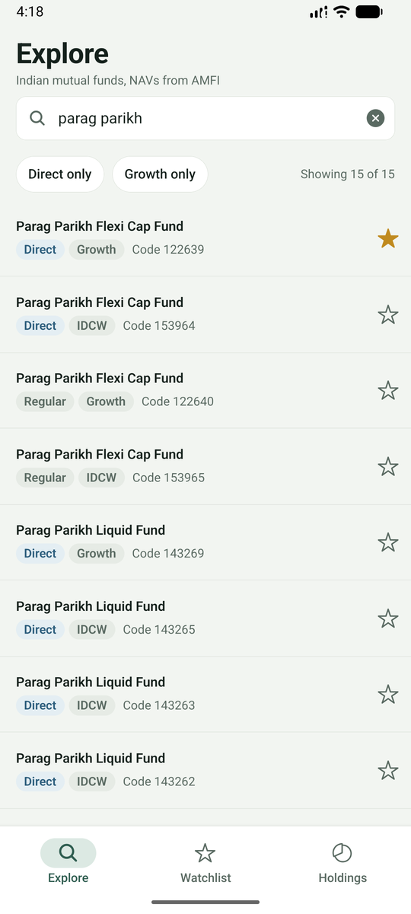
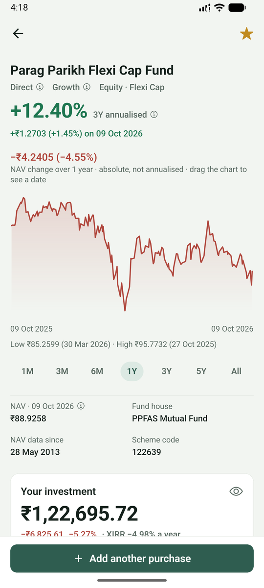
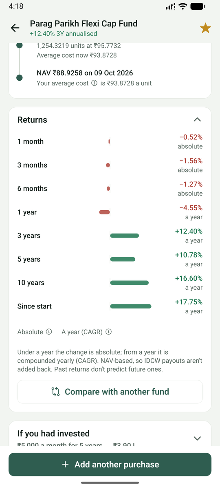
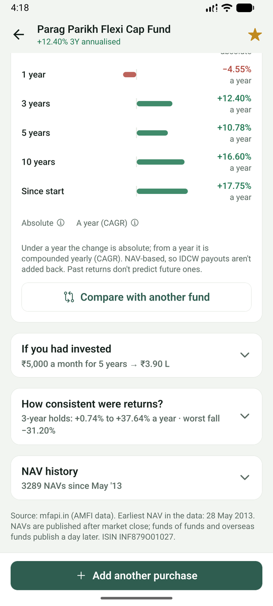
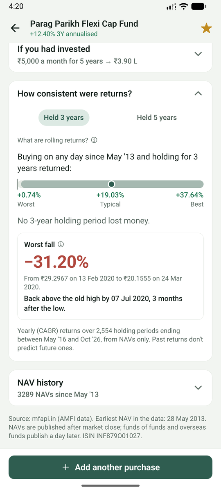
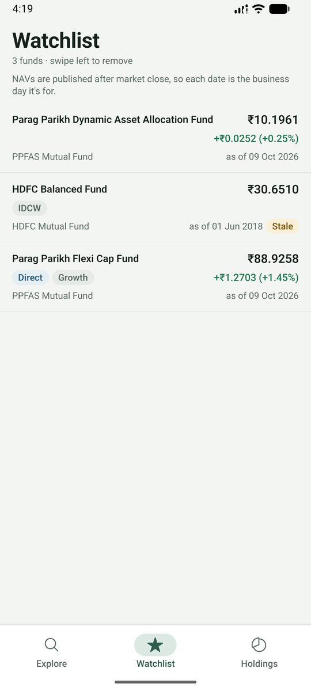
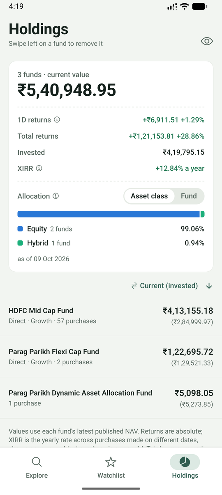
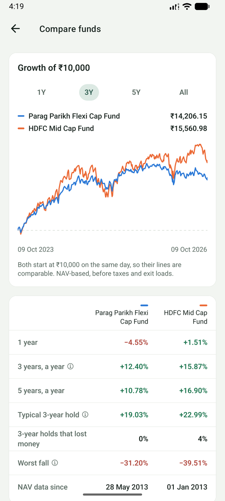

# Mutual Fund Explorer

Search Indian mutual funds, read a fund's NAV history, keep a watchlist, and record holdings to see their current value and return. Built with Expo (managed workflow) and TypeScript on the free [mfapi.in](https://www.mfapi.in/) API.

## Run it

**You need:** Node.js ^20.19.4, ^22.13.0 or ^24.3.0 (22 LTS recommended); the **Expo Go** app (SDK 57) on an Android or iOS phone, or an emulator; and internet access to `https://api.mfapi.in`. There are no API keys and no environment variables.

```bash
npm install
npx expo start
```

Scan the QR code with Expo Go (Android) or the Camera app (iOS). With an emulator running, press `a` for Android or `i` for the iOS simulator.

### If Expo Go says the project needs a different SDK

This project uses **Expo SDK 57**, which the store version of Expo Go runs as of October 2026. SDK 58 is in beta; after it's released, the store app will move to SDK 58 and stop opening SDK 57 projects. If that has happened:

1. **Android emulator:** run `npx expo start` and press `a`. Expo CLI installs the Expo Go build that matches the project.
2. **Development build:** `npx expo run:android` (needs Android Studio) or `npx expo run:ios` (needs Xcode on macOS).
3. **Upgrade:** once SDK 58 is stable, run `npx expo install expo@^58.0.0 --fix`, then `npm run check`.

## Checks

| Command | What it does |
|---|---|
| `npm run typecheck` | TypeScript, strict |
| `npm test` | Jest: 150+ tests on dates, money, NAV rules, parsing, the API client and the store |
| `npm run check` | Both |

## Screenshots

Android emulator, light mode, Expo Go (SDK 57).

| Explore | Fund | Your investment | Returns |
|---|---|---|---|
|  |  |  |  |

| Consistency and worst fall | Watchlist | Holdings | Compare |
|---|---|---|---|
|  |  |  |  |

## Features

- **Explore:** recently viewed funds with their NAV and today's move; search by name (debounced, from 2 characters, whole words), Direct/Regular and Growth/IDCW badges parsed from scheme names, "Direct only" and "Growth only" filters, a star to watch any fund, and suggestion chips before you type. Typing a scheme code opens that scheme directly.
- **Fund screen:** the 3-year annualised return and today's move up front, a chart with 1M to All ranges and touch scrubbing, key facts, your own investment (value, return, XIRR, and every purchase on a timeline with your average cost after each), then collapsible sections that state their takeaway while closed: trailing returns from 1M to 10Y as a bar chart, "If you had invested" (a monthly SIP or one-time investment replayed on the fund's real NAVs), "How consistent were returns?" (worst, typical and best 3- and 5-year holding periods, plus the worst fall and how long it took to recover), and the full NAV history.
- **Compare:** two funds on one chart as the growth of ₹10,000 from the same day, and a side-by-side table of returns, consistency and worst fall.
- **Watchlist:** each fund's latest NAV with its date and today's change, a Stale flag for NAVs over 7 days old, pull to refresh, swipe to remove with Undo, and offline display from the saved cache.
- **Holdings:** one row per fund with value, returns or XIRR (switchable, sortable); a summary with today's change, total return, invested, XIRR across purchases, and allocation by asset class or by fund; an eye toggle that hides rupee amounts.
- **Adding purchases:** one purchase by units and date, or a monthly SIP in one go (amount and start date; every instalment priced at its first NAV on or after the date). The app's own calendar jumps by year and greys out dates outside the fund's data.
- **For newcomers:** a plain-language explanation behind an ⓘ wherever a term like NAV, XIRR, CAGR, IDCW or Direct appears.

Design decisions, component by component, are in [docs/DESIGN.md](docs/DESIGN.md).

## Requirements and where they are handled

| Requirement | How it's met |
|---|---|
| Search schemes by name | Explore tab; `useSchemeSearch` (300 ms debounce, cached, previous results kept while typing) |
| Fund details and NAV history (chart and/or list) | Fund screen (chart, returns, recent NAVs) and the NAV history list (`FlatList`, thousands of rows) |
| Watchlist with latest NAV and last-updated date | Watchlist tab; every NAV is shown with its date |
| Holding (units, purchase date) → current value and overall return | Add-holding form and Holdings tab; exact BigInt maths in `src/domain/valuation.ts` |
| Remove from watchlist / holdings | Remove with Undo (watchlist); remove after a confirmation (holdings) |
| Currency and number formatting | `src/domain/format.ts`: ₹, Indian grouping (₹1,23,456.78), NAVs to 4 decimals, true minus sign for losses, `+` for gains |
| Loading, empty and error states | Every data screen: skeletons, an empty state with a next step, and errors that name the cause, with Retry |
| Slow, unavailable or incomplete API | 15 s timeouts (20 s for full histories), typed errors, retries only where they can help, an offline cache of latest NAVs, malformed rows skipped and counted |
| Large NAV histories stay smooth | LTTB downsampling to about 150 chart points; fixed-height `FlatList` rows with `getItemLayout` |
| Non-trading days, short or gappy history | A purchase gets the **first NAV on or after** its date; "Awaiting NAV" until it's published; dates before the earliest NAV are rejected; gap warnings and markers |
| Negative returns | Signed formatters, true minus sign, colour plus a word; covered by tests |
| Holding form validation | `validateUnits` (positive, at most 4 decimals, no commas or exponents) and `describePurchaseDate` (no future dates, no dates before the data) |
| Persistence (optional) | Zustand `persist` on AsyncStorage, versioned, and validated on every load |

## Project structure

```
src/
  app/          routes (Expo Router): (tabs)/index, watchlist, holdings; fund/[code]/index, navs; add-holding
  components/   ui/, search/, fund/, form/, watchlist/, holdings/
  domain/       pure rules: dates, calendar, decimal, format, nav, returns, longTerm, xirr, sip, compare, holdings,
                assetClass, valuation, validation, chart, search, signed, glossary
  api/          mfapi.in client, response parsing, typed errors, real-payload fixtures
  query/        TanStack Query client, keys, options, data hooks, persistence
  store/        Zustand portfolio store and its pure transitions
  hooks/        debounce, connectivity, refresh on focus, pending-lot resolver
  theme/        tokens and useTheme
docs/           ARCHITECTURE.md, DESIGN.md, PERSONAS.md, BUILD_PROMPT.md, BUILD_LOG.md, RUNBOOK.md
AI_CONTEXT.md   how AI tools were used and directed
```

The decisions behind this layout, the date and money rules, and the trade-offs are in [docs/ARCHITECTURE.md](docs/ARCHITECTURE.md).

## Known limitations

- **Date, not time.** The form records a purchase date, so it can't model the 3 pm cut-off. For an exact match, enter the allotment date from your statement.
- **mfapi.in is a free community API.** It has no service guarantee and its rate limits aren't published. Its history can lag `/latest` by a day, and for some schemes it starts after the fund's launch, so the app says "earliest NAV available".
- **Search matches whole words, up to 15 results.** That's how mfapi.in's search works: "parag" finds Parag Parikh funds, "par" finds nothing. The app tells you to type full words, and to add words when 15 results come back.
- **Returns are NAV-based.** IDCW payouts aren't added back, and exit loads, stamp duty and taxes aren't modelled.
- **Units use a dot for decimals.** Commas are rejected rather than guessed, because "1,254" could be a thousands separator.
- **A SIP added in one go shows "invested" as units × NAV.** Units are kept to 4 decimals, so a ₹5,000 instalment can show as ₹4,999.99; the SIP preview shows the rupees actually paid. Recording the paid amount per purchase would need a change to the saved data format.
- **Totals are summed exactly, then rounded**, so they can differ from the sum of the rounded rows by a paisa.
- Mobile only: web isn't a target.

## Environment and data notes

- No `.env` file is needed. The API base URL is in `src/api/client.ts`.
- Everything is stored on the device in AsyncStorage: the watchlist and holdings under `mfx.portfolio`, and cached latest NAVs under `mfx.query-cache` (kept for 7 days). Clearing the app's data resets both.
- On a network that blocks `api.mfapi.in` (some office networks do), test on mobile data.

## Troubleshooting

- **"Project is incompatible with this version of Expo Go":** see the SDK section above.
- **Expo Go shows "Failed to download remote update" after relaunching in airplane mode:** in development, Expo Go downloads the app's code from Metro at each launch. To test offline on an Android emulator, run `adb reverse tcp:8081 tcp:8081` and open `exp://127.0.0.1:8081`; the code then arrives over adb while the API stays unreachable.
- **Odd bundling errors after switching branches:** `npx expo start -c` clears Metro's cache.
- **Jest says the React Native preset has moved:** `npm install --save-dev @react-native/jest-preset@^0.86.3`.

## How it was built

AI tools were used for research, for the verified domain core, and to build the screens through a phased plan. See [AI_CONTEXT.md](AI_CONTEXT.md), [docs/BUILD_PROMPT.md](docs/BUILD_PROMPT.md) and [docs/BUILD_LOG.md](docs/BUILD_LOG.md).
